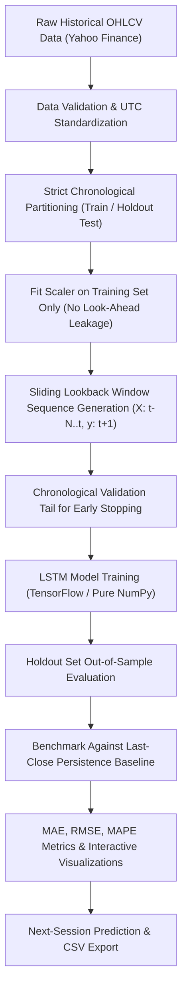

# Stock Price Prediction Using LSTM

[](https://github.com/shivangsaxena1011/stock-forecasting/actions/workflows/ci.yml)
[](https://www.python.org/)
[](https://opensource.org/licenses/MIT)
[](https://streamlit.io/)
[](https://fastapi.tiangolo.com/)

An educational and research time-series forecasting system that downloads genuine historical daily market data for Indian National Stock Exchange (NSE) and US equities, trains an LSTM recurrent neural network, evaluates performance on an unseen chronological holdout set, benchmarks against a naive persistence baseline, and serves results through an interactive Streamlit dashboard and a RESTful FastAPI backend.

---

## Live Demo & Repository

- **Live Application:** [Stock Price Forecasting Dashboard](https://shivang-stock-forecasting.streamlit.app/)
- **GitHub Repository:** [shivangsaxena1011/stock-forecasting](https://github.com/shivangsaxena1011/stock-forecasting)

---

## Project Overview

Financial market time series exhibit high volatility, non-stationarity, and dynamic regime changes. The primary engineering goal of this project is to implement a robust, leak-free machine learning workflow for next-day closing price estimation, evaluate its true generalization capabilities on genuine out-of-sample holdout observations, and contrast the neural network against a naive persistence baseline.

> **Important Disclaimer:** This application is developed strictly for educational demonstration, software engineering analysis, and time-series research. Financial markets are non-stationary and subject to systemic risks. Model forecasts are mathematical point estimates and must not be used as financial, trading, or investment advice. No synthetic or mock market data is ever generated.

---

## Key Features

- **Genuine Historical Market Data:** Directly ingests daily OHLCV market history via `yfinance` for Indian NSE equities (`RELIANCE.NS`, `TCS.NS`, `INFY.NS`, `HDFCBANK.NS`, `SBIN.NS`) and US equities (`AAPL`, `MSFT`, `NVDA`, `AMZN`, `TSLA`).
- **Data Leakage Prevention:** Feature scaling (`RobustMinMaxScaler`) is fitted strictly on historical training observations and never fitted across the entire dataset.
- **Strict Chronological Splitting:** Observations are partitioned sequentially (default: 80% train / 20% holdout test) with an internal chronological validation tail for early stopping. No random shuffling is performed.
- **Dual Engine Architecture:** Supports full TensorFlow/Keras LSTM networks while providing a pure NumPy analytical LSTM engine (`PureNumPyLSTM`) with Xavier initialization, backpropagation through time (BPTT), Adam optimization, and best validation weight restoration.
- **Persistence Baseline Benchmark:** Benchmarks holdout predictions against a naive last-close persistence baseline across MAE, RMSE, and MAPE. Reports underperformance honestly without holdout data snooping.
- **Responsive Streamlit Dashboard:** Features dynamic ticker selection, synchronized inputs, data-bound caching, session state invalidation, and interactive Plotly visualizations across mobile, tablet, and desktop viewports.
- **Interactive CSV Export:** Directly downloads holdout evaluation datasets containing actual closes, LSTM predictions, and baseline figures.
- **Hardened RESTful FastAPI Backend:** Headless API (`api.py`) exposing `/health`, `/tickers`, and `/predict` with period allowlists, rate limiting, and concurrency control.
- **Automated Continuous Integration:** Multi-version CI workflow (`.github/workflows/ci.yml`) validating dependencies, app imports, and offline tests on Python 3.11 and 3.12.

---

## Technology Stack

- **Runtime & Language:** Python 3.11 / 3.12
- **Data Processing:** `pandas`, `numpy`
- **Data Ingestion:** `yfinance` (Yahoo Finance API)
- **Deep Learning:** `tensorflow` / `keras` (primary) and native `PureNumPyLSTM` (analytical engine fallback)
- **Web Applications:** `streamlit` (interactive dashboard), `fastapi` & `uvicorn` (REST API backend)
- **Visualization:** `plotly`, `matplotlib`
- **Quality Assurance & Testing:** `pytest` (offline suite and live integration testing)

---

## Forecasting Methodology



1. **Ingestion & Validation:** Daily split-adjusted closing prices are downloaded, verified for continuity, sorted chronologically, and checked for minimum required observations.
2. **Train/Test Slicing:** The series is split chronologically into training ($80\%$) and unseen test ($20\%$) sets.
3. **Train-Only Scaling:** Normalization bounds $[x_{min}, x_{max}]$ are computed strictly on training data.
4. **Sequence Construction:** A sliding window of $N$ sessions maps $[P_{t-N}, \dots, P_t]$ to target $P_{t+1}$.
5. **Model Training & Checkpointing:** The model is trained with Adam optimization and early stopping, restoring optimal validation weights.
6. **Persistence Benchmarking:** The model is benchmarked against the naive prediction $\hat{y}_{t+1} = y_t$.

---

## Evaluation Results

The verified holdout evaluation results for **Tata Consultancy Services (`TCS.NS`)** across 248 trading sessions (`2025-10-09` to `2026-10-09`) from [`outputs/TCS_NS_test_predictions.csv`](outputs/TCS_NS_test_predictions.csv):

| Metric | LSTM Neural Network | Persistence Baseline ($\hat{y}_{t+1} = y_t$) | Better Performance |
|---|---:|---:|:---:|
| **Mean Absolute Error (MAE)** | **₹192.11** | **₹32.14** | **Persistence Baseline** |
| **Root Mean Squared Error (RMSE)** | **₹227.12** | **₹45.02** | **Persistence Baseline** |
| **Mean Absolute Percentage Error (MAPE)** | **8.25%** | **1.29%** | **Persistence Baseline** |

### Key Empirical Finding
In accordance with market micro-structure theory and the Efficient Market Hypothesis, daily asset price levels exhibit strong random-walk characteristics. Yesterday's observed closing price is statistically difficult for a univariate point forecaster to outperform on out-of-sample data. The application acknowledges this honestly: we do not artificially tune hyperparameters on holdout data or conceal baseline superiority.

> *Note: These figures reflect a single historical holdout evaluation and do not represent guaranteed future performance.*

---

## Repository Structure

```text
stock-forecasting/
├── app.py                     # Responsive Streamlit dashboard application
├── api.py                     # Production-hardened FastAPI REST backend
├── requirements.txt           # Lightweight production dependencies (Streamlit Cloud)
├── requirements-dev.txt       # Development, testing, Jupyter & API dependencies
├── README.md                  # Project documentation & portfolio overview
├── LICENSE                    # MIT Open Source License
├── .env.example               # Configuration template for CORS and rate limits
├── pytest.ini                 # Pytest configuration with default offline test filter
├── .github/workflows/ci.yml   # GitHub Actions continuous integration workflow
├── src/
│   ├── __init__.py
│   └── stock_forecaster.py    # Core forecasting engine, PureNumPyLSTM, scaler & metrics
├── tests/
│   ├── __init__.py
│   ├── conftest.py            # Test suite fixtures
│   ├── test_app.py            # Streamlit dashboard caching and state tests
│   ├── test_api.py            # FastAPI REST endpoint & validation tests
│   └── test_stock_forecaster.py # Scaler, sequence, gradient & engine unit tests
├── notebooks/
│   └── Stock_Price_Prediction_LSTM.ipynb  # Executed research notebook with plots
├── docs/
│   ├── AUDIT_REPORT.md        # Detailed vulnerability audit and remediation report
│   ├── TEST_REPORT.md         # Full test suite execution logs and evidence
│   ├── PROJECT_REPORT.md      # Engineering report with methodology and metrics
│   └── FLOWCHART.md           # System architecture diagrams
└── outputs/
    ├── TCS_NS_test_predictions.csv       # Verified holdout predictions export
    ├── RELIANCE_NS_test_predictions.csv  # Verified holdout predictions export
    └── screenshots/                      # Rendered viewport screenshots
```

---

## Automated Testing

The repository maintains an automated test suite verifying data transformations, numerical gradient accuracy, weight restoration, FastAPI routes, and Streamlit state logic.

By default, running `pytest` executes the **offline test suite** (40 deterministic unit tests, completely independent of the internet):
```bash
python -m pytest -v
```

To run the live Yahoo Finance integration test (requires active internet access):
```bash
python -m pytest -m "integration" -v
```

To run all 41 test cases (offline tests + live integration smoke test):
```bash
python -m pytest -m "" -v
```

---

## Limitations & Disclaimer

- **Upstream Provider Dependency:** Market data retrieval relies on Yahoo Finance service availability and rate limits.
- **Univariate Input Scope:** The model utilizes historical closing prices; corporate earnings releases, macroeconomic news, and order book dynamics are not modeled.
- **Non-Stationary Markets:** Financial market dynamics undergo structural regime shifts where historical correlations may not persist.
- **Baseline Dominance:** On daily close price levels, naive persistence baselines often outperform univariate recurrent neural networks.
- **Educational Purpose:** All predictions are mathematical point estimations and must not be used as financial, investment, or trading advice.

---

## License

This project is licensed under the [MIT License](LICENSE).
