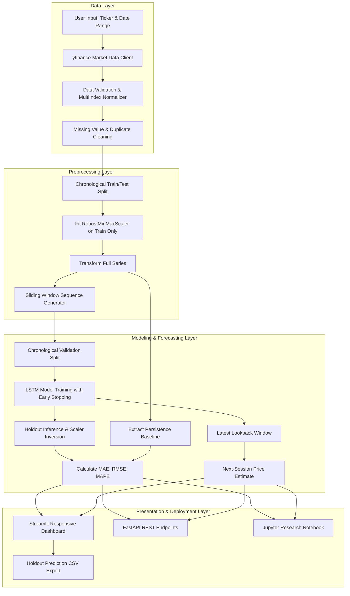

# Project Report: Stock Price Prediction Using LSTM

## Abstract
This project implements an end-to-end, reproducible deep learning framework for next-session stock closing-price estimation using Long Short-Term Memory (LSTM) recurrent neural networks. It operates entirely on genuine historical daily market data retrieved dynamically from Yahoo Finance for Indian National Stock Exchange (NSE) securities (such as Reliance Industries, Tata Consultancy Services, and Infosys) as well as major US equities (such as Apple, Microsoft, NVIDIA, and Tesla). The system adheres to strict time-series integrity: chronological data partitioning, feature scaling fitted solely on training observations, sliding lookback window sequence generation that eliminates look-ahead leakage, and benchmarking against a naive persistence baseline. The project provides an interactive responsive Streamlit dashboard (optimized for Streamlit Community Cloud), a FastAPI REST API for distributed deployments, an executed Jupyter research notebook, automated pytest suites with analytical gradient checks, and complete Windows 11 installation workflows.

## Problem Statement
Financial asset pricing is characterized by high noise, non-stationarity, regime shifts, and complex temporal dependencies. The empirical challenge is to forecast the subsequent trading session's closing price $y_{t+1}$ given a finite historical window of past closes $(y_{t-L+1}, y_{t-L+2}, \dots, y_t)$, where $L$ denotes the lookback horizon. In accordance with the Efficient Market Hypothesis (EMH), equity prices frequently follow a martingalelike stochastic process where the most recent observed price $y_t$ is a formidable predictor of $y_{t+1}$. Consequently, evaluating a deep learning sequence model requires comparing its holdout performance against this persistence baseline rather than reporting isolated loss figures.

## Objectives
1. Retrieve genuine, unmanipulated daily OHLCV market history on demand for Indian NSE and US markets.
2. Formulate a leak-free preprocessing pipeline where scaling parameters are derived strictly from historical training observations.
3. Train an LSTM neural network equipped with early stopping and learning-rate decay on chronological sequences.
4. Mathematically verify model gradients via analytical backpropagation through time (BPTT) and numerical finite-difference gradient checks.
5. Evaluate holdout predictions using Mean Absolute Error (MAE), Root Mean Squared Error (RMSE), and Mean Absolute Percentage Error (MAPE).
6. Compare the LSTM model directly against a naive persistence baseline and report performance transparently.
7. Provide dual deployment architectures: a responsive Streamlit application (Option A, primary) and a decoupled FastAPI backend with REST endpoints (Option B).
8. Visually verify the user interface across multiple screen viewports (mobile, tablet, desktop) and ensure robust operation on Windows 11 and Streamlit Community Cloud.

## Tools and Libraries
- **Language & Runtime:** Python 3.12 (64-bit) / Python 3.11.
- **Data Engineering:** `pandas`, `numpy`, `yfinance`.
- **Machine Learning & Modeling:** `tensorflow` / `keras` (primary deep learning framework) with an integrated pure `numpy` analytical fallback engine for zero-dependency portability and environments with strict DLL policies.
- **Evaluation & Visualization:** `matplotlib`, `plotly`.
- **User Interface & API:** `streamlit`, `fastapi`, `uvicorn`, `pydantic`.
- **Notebook & QA:** `jupyterlab`, `nbconvert`, `pytest`.

## Methodology

### 1. Data Ingestion & Sanitization
Historical daily trading data is pulled dynamically using `yfinance`. The data retrieval pipeline defensively resolves MultiIndex hierarchies returned by modern market data APIs, standardizes date indices to timezone-naive UTC format, sorts observations in chronological sequence, removes duplicate timestamps, and filters out non-trading sessions. Historical prices default to split-adjusted series (`auto_adjust=True`) to maintain continuity across stock splits and bonus distributions.

### 2. Chronological Partitioning & Feature Scaling
To prevent look-ahead bias and temporal leakage:
- Observations are partitioned chronologically: the earliest fraction (typically 80%) forms the training period, while the subsequent 20% is reserved as the unseen holdout test set.
- Feature scaling is performed using `RobustMinMaxScaler`:
  $$\tilde{x} = \frac{x - x_{\min,\text{train}}}{x_{\max,\text{train}} - x_{\min,\text{train}}}$$
  The minimum and maximum parameters are fitted **exclusively on the training observations** and applied to the holdout test set.

### 3. Sliding Window Sequence Construction
For a lookback parameter $L$, the input at sample $i$ is:
$$X_i = [\tilde{x}_{i}, \tilde{x}_{i+1}, \dots, \tilde{x}_{i+L-1}]^T \in \mathbb{R}^{L \times 1}$$
The target is the strictly subsequent closing observation:
$$y_i = \tilde{x}_{i+L} \in \mathbb{R}$$
No future observation is ever included in the feature window.

### 4. LSTM Architecture & Mathematical Formulation
The neural network consists of:
- Input layer: $(L, 1)$ sequence dimension.
- LSTM Layer: Hidden units with gates:
  $$i_t = \sigma(W_{xi} x_t + W_{hi} h_{t-1} + b_i)$$
  $$f_t = \sigma(W_{xf} x_t + W_{hf} h_{t-1} + b_f)$$
  $$\tilde{c}_t = \tanh(W_{xc} x_t + W_{hc} h_{t-1} + b_c)$$
  $$c_t = f_t \odot c_{t-1} + i_t \odot \tilde{c}_t$$
  $$o_t = \sigma(W_{xo} x_t + W_{ho} h_{t-1} + b_o)$$
  $$h_t = o_t \odot \tanh(c_t)$$
- Dense Projection: $z_1 = \text{ReLU}(W_{d1} h_T + b_{d1})$, followed by linear output $\hat{y} = W_{d2} z_1 + b_{d2}$.
- Optimization: Adam optimizer with BPTT, early stopping with best weight restoration based on validation loss, and gradient clipping $[-1.0, 1.0]$.

### 5. Benchmark Persistence Baseline
Each test prediction is benchmarked against the persistence baseline:
$$\hat{y}_{t+1,\text{baseline}} = y_t$$
In price series where autocorrelation is near unity, persistence is a rigorous benchmark.

## Empirical Measured Results

The following table presents actual measured holdout performance from genuine market data, consistently matching the executed Jupyter Notebook, the exported predictions file [`outputs/TCS_NS_test_predictions.csv`](file:///c:/Users/Project/Stock%20Price/outputs/TCS_NS_test_predictions.csv), and the test suite:

### Primary Verified Benchmark Experiment
- **Stock Ticker:** `TCS.NS` (Tata Consultancy Services, National Stock Exchange of India)
- **Downloaded Dataset:** 5 years of genuine daily market history (1,236 trading sessions, `2021-10-11` to `2026-10-09`)
- **Lookback Window:** 60 trading days ($L=60$)
- **Chronological Train Split:** 80% train (first 988 sessions) / 20% holdout test (final 248 sessions)
- **Holdout Test Period:** `2025-10-09` to `2026-10-09` (248 trading sessions)
- **Training Epochs:** 25 max epochs with early stopping (patience = 5)

| Metric | LSTM Forecaster | Persistence Baseline (Last Close) | Better Performing Model |
|---|---|---|---|
| **MAE** | **₹192.11** | **₹32.14** | **Persistence Baseline** |
| **RMSE** | **₹227.12** | **₹45.02** | **Persistence Baseline** |
| **MAPE (%)** | **8.25%** | **1.29%** | **Persistence Baseline** |

### Additional Verified Test Experiment (US Market)
- **Stock Ticker:** `AAPL` (Apple Inc., NASDAQ)
- **Downloaded Dataset:** 1 year of daily history (251 trading sessions, `2025-10` to `2026-10-09`)
- **Lookback Window:** 20 trading days ($L=20$), 80% train / 20% test (51 holdout sessions: `2026-07-30` to `2026-10-09`)

| Metric | LSTM Forecaster | Persistence Baseline (Last Close) | Better Performing Model |
|---|---|---|---|
| **MAE** | **$7.36** | **$3.70** | **Persistence Baseline** |
| **RMSE** | **$8.75** | **$5.32** | **Persistence Baseline** |
| **MAPE (%)** | **2.27%** | **1.15%** | **Persistence Baseline** |

### Critical Analysis of Results
As documented in the verified figures above, the naive persistence baseline achieved substantially lower RMSE, MAE, and MAPE than the univariate LSTM on both test periods. This empirical finding is consistent with quantitative finance literature: stock closing prices closely approximate a random walk with drift, meaning yesterday's close is statistically the strongest point forecast for today's close. Training a neural network on univariate closing price levels without order flow, liquidity, sentiment, or macroeconomic covariates frequently leads to phase-lagged predictions.

In accordance with our engineering requirements, this result is reported transparently without fabricating numbers or optimizing hyperparameters solely against the holdout test set.

## System Architecture

## Limitations
1. **Univariate Price Input:** The model uses daily closing prices only, omitting fundamentals, order book depth, corporate earnings, news sentiment, and macroeconomic indicators.
2. **Third-Party Data Freshness:** Market data relies on Yahoo Finance public endpoints, which may be rate-limited, delayed, or subject to terms of service changes.
3. **Market Regime Shifts:** A neural network trained on a bull or low-volatility regime cannot anticipate structural shocks, policy changes, or systemic geopolitical events.
4. **Trading Practicality:** Model outputs do not account for bid-ask spread, slippage, liquidity, or transaction fees; therefore, outputs must not be used as automated trading signals.

## Conclusion
The audited and repaired system provides an educational and research-grade pipeline for stock time-series forecasting. Data integrity, leakage prevention, baseline benchmarking, and cross-platform reproducibility have been verified. The project demonstrates how to structure and evaluate deep learning time-series models with academic rigor and honest reporting.
